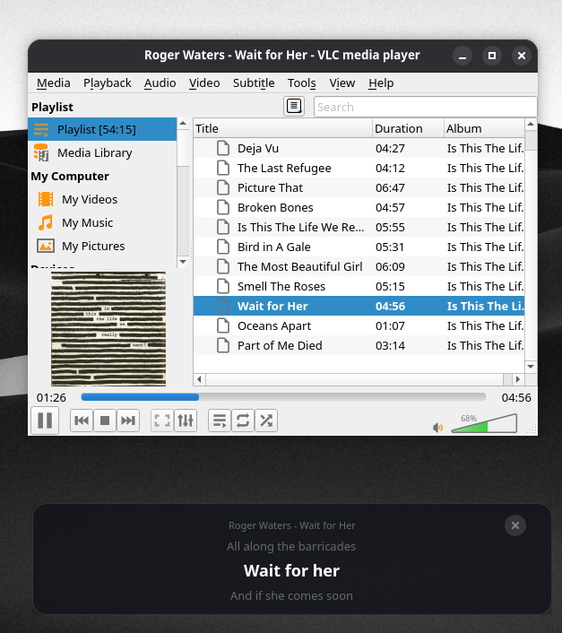

# VLC Lyrics Overlay



Floating lyrics overlay for VLC on Linux. Reads the current track over MPRIS D-Bus and shows synced lyrics — previous, current, and next line.

Lyrics come from a local `.lrc` file next to the music file, or from [LRCLIB](https://lrclib.net) if none exists. Results are cached in memory so switching back to a song doesn't re-fetch.

Wrong or missing lyrics? Click ⟳ (or press `r`) to try the next match. It works down from an exact match to looser searches, then goes back to the best one.

Borderless, draggable, dark card. Close with the × button, `Esc`, or `q`.

## Requirements

Python 3, GTK 4, PyGObject.

```bash
# Arch
sudo pacman -S python-gobject gtk4
```

## Install

```bash
curl -sSL https://raw.githubusercontent.com/aradar46/vlc_lyrics_display/main/install.sh | bash
```

Or from a local clone:

```bash
git clone https://github.com/aradar46/vlc_lyrics_display.git
cd vlc_lyrics_display
./install.sh
```

Installs to `~/.local/share/vlc-lyrics`, puts a launcher in `~/.local/bin/vlc-lyrics`, and adds a desktop entry with icon.

## Usage

1. Play something in VLC.
2. Open **VLC Lyrics Overlay** from the app grid, or run `vlc-lyrics`.
3. Drag it where you want it.

## Uninstall

```bash
~/.local/share/vlc-lyrics/install.sh --uninstall
```
