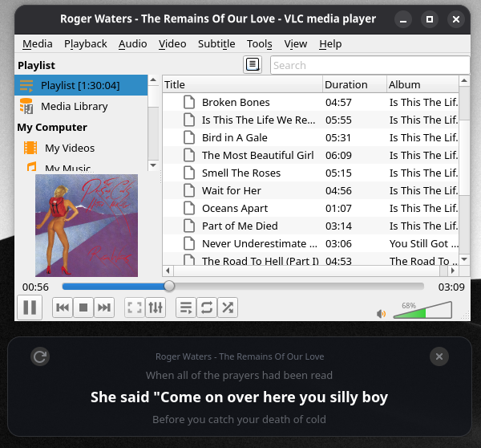

# VLC Lyrics Overlay



Floating lyrics overlay for VLC on Linux.  

1. Play something in VLC.
2. Open **VLC Lyrics Overlay** from the app grid, or run `vlc-lyrics`.
3. Drag it where you want it.
4. Wrong or missing lyrics? Click ⟳

Lyrics come from a local `.lrc` file next to the music file, or from  https://lrclib.net if none exists. Results are cached in memory so switching back to a song doesn't re-fetch.


## Install

Requires Python 3, GTK 4, PyGObject.

```bash
## Arch
# sudo pacman -S python-gobject gtk4

curl -sSL https://raw.githubusercontent.com/aradar46/vlc_lyrics_display/main/install.sh | bash

## Installs to `~/.local/share/vlc-lyrics`, puts a launcher in `~/.local/bin/vlc-lyrics`, and adds a desktop entry with icon.

# uninstall
## ~/.local/share/vlc-lyrics/install.sh --uninstall
```